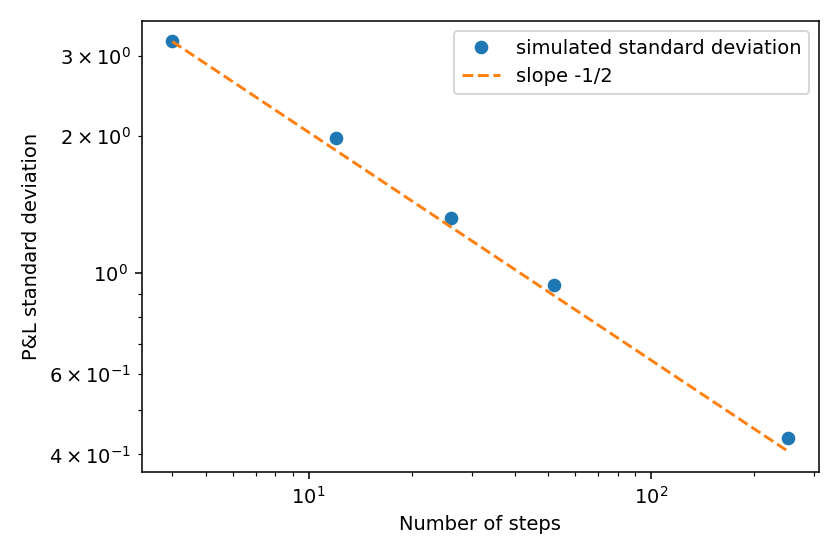
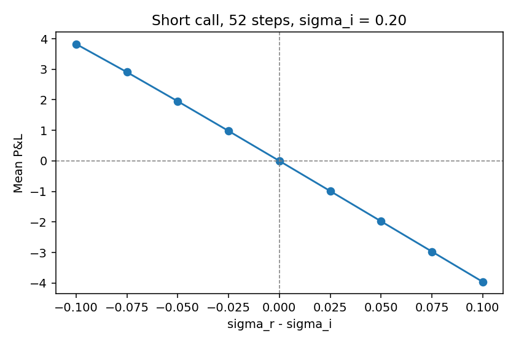
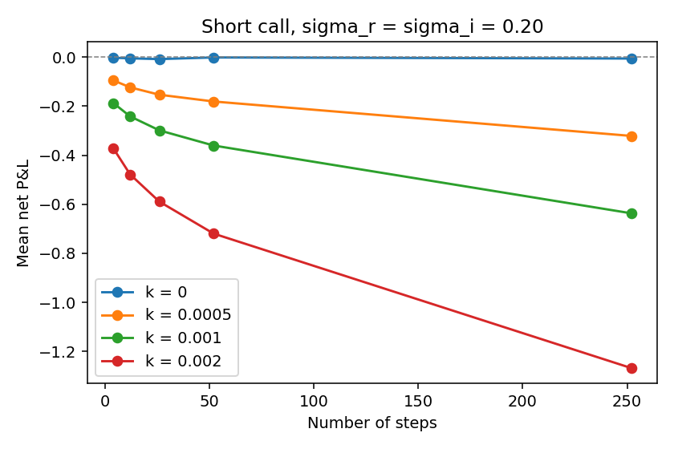
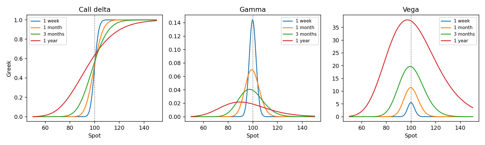

# Option pricing and delta hedging

A from-scratch Black-Scholes pricer, its Greeks, and a discrete delta hedge of a short European call. The point is the link between the price, the hedge, and the residual risk: the daily problem of an options market maker.

No pricing library. NumPy, SciPy, and Matplotlib only. European options, no dividends, constant continuous rate, constant volatility. Time is in years.

## What the hedge does

A call is sold at the Black-Scholes price computed with an implied volatility \(\sigma_i\). The hedge buys \(\Delta = N(d_1)\) shares, and that delta is recomputed on a grid of dates, still with \(\sigma_i\). The spot itself follows a geometric Brownian motion with a realized volatility \(\sigma_r\), which can differ from \(\sigma_i\). Cash is compounded at the continuous rate \(r\). At maturity the call payoff is paid and the shares are sold. The cash left is the P&L.

\(\sigma_i\) and the rebalance frequency are choices of the trader. \(\sigma_r\) is not: it is what the path does after the sale.

## Results

Reference contract: \(S = K = 100\), \(T = 1\) year, \(r = 0.05\), \(\sigma_i = 0.20\). The at-the-money call is worth 10.4506.

- Put-call parity holds to `1e-10`, including at expiry and at zero volatility. A Monte Carlo of \(10^6\) terminal spots puts the closed-form price inside the 95% interval.
- Delta, gamma, vega, theta, and rho match central finite differences. Call and put share gamma and vega. Theta is \(\partial V/\partial t\), so it is minus a bump of maturity.
- When \(\sigma_r = \sigma_i\), the mean P&L is about 0 (within a few cents on 4,000 paths). The standard deviation falls like \(1/\sqrt{N}\): about 3.2 with 4 rebalances, 0.44 with 252.
- When \(\sigma_r\) rises above \(\sigma_i\), the mean P&L of the short call turns negative, and by about the same amount when \(\sigma_r\) falls short. A 52-step hedge loses about 4 with \(\sigma_r = 0.30\) and gains about 4 with \(\sigma_r = 0.10\). That is the short-gamma exposure \(\tfrac12 \Gamma S^2 (\sigma_i^2 - \sigma_r^2)\).
- Proportional transaction costs \(k\,|\Delta q|\,S\) do not change the sign of that vol P&L, but they punish frequent hedging. With \(k = 0\) the mean stays on zero at every frequency. With \(k = 0.002\) (20 basis points of traded notional) the mean goes from about \(-0.3\) at 4 steps to about \(-1.3\) at 252 steps. Hedging more often reduces variance and increases the bill.







Near expiry the call delta has to jump from 0 to 1 at the strike. Gamma is that slope, so it blows up at the money as \(T \to 0\), while vega, which carries a \(\sqrt{T}\), dies out.



The formulas and the hedge accounting are written out in [docs/notes.md](docs/notes.md).

## Layout

| File | Role |
|---|---|
| `bs.py` | Call and put prices. `parity_holds` checks \(C - P = S - Ke^{-rT}\). |
| `greeks.py` | Closed-form delta, gamma, vega, theta, rho. |
| `monte_carlo_check.py` | Closed form against a \(10^6\)-path confidence interval. |
| `hedge_sim.py` | Spot paths and `hedge_pnl`. |
| `experiments.ipynb` | The four figures above. |
| `docs/notes.md` | Model, formulas, hedge accounting, gamma scalping. |

## Run

```bash
pip install -r requirements.txt
python bs.py
python greeks.py
python hedge_sim.py
python monte_carlo_check.py   # one million paths, a few seconds
```

Each script prints `OK` or `FAIL`. The notebook uses the same functions. Seeds are fixed, so the Monte Carlo interval and the hedge paths repeat.

`hedge_pnl(S0, K, T, r, sigma_i, sigma_r, n_steps, n_paths, seed, k=0.0)` returns one P&L per path, already expressed at maturity. `k` is the fraction of traded notional charged on every share trade, including the opening hedge and the final unwind.
